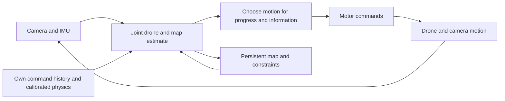

# The controller

One controller holds an uncertain estimate of the drone, its surroundings and its
own dynamics. It uses that estimate to choose a motor command. The command changes
both the drone's motion and the measurements it will get next. Surveying and
racing are two objectives for this same closed loop.

Mapping and localization are one estimation problem. Planning and motor control
act on its current result. The drone can move using a small, uncertain piece of
map; new observations extend or correct that map while it flies.

This is the design contract. The implementation status is listed at the end.

The state includes position, velocity, attitude, angular velocity, sensor biases
and actuator response. The map includes physical landmark identities, gate poses,
their dimensions, useful background features and uncertainty. Calibration covers
the camera, sensor clocks and the relation between motor commands and motion.
The route is an ordered sequence of landmark identities. A gate's identity and
its place in the route are different things.

Formally the controller maintains a belief:

\[
b_t = p(x_t,M,\theta,c_{0:t}\mid I_{0:t},y^{\rm IMU}_{0:t},u_{0:t-1}).
\]

Here `x` is drone state, `M` is the map, `theta` is calibration, `c` is observation
association, `I` is camera data and `u` is our sent motor command. The estimator
must carry their correlations. A new rectangle can be a previously seen gate, the
next gate or a farther gate; counting it as the next gate does not establish its
identity. Ambiguous observations remain tentative.

The first flight starts with priors. Quiet IMU measurements initialize tilt;
visible gate pixels and known dimensions seed uncertain landmark hypotheses.
Initialize velocity from a justified rest prior, or infer initial motion from
several views. A later flight matches current observations to retained landmarks
to estimate its starting pose in the same map.

Each update predicts motion from the IMU and previous motor commands, predicts
what the camera should see, and compares that prediction with the new pixels.
The discrepancy corrects the drone state and map together. Planning uses this
updated estimate to choose the next short movement; motor feedback executes it.
The resulting measurements begin the next update. This is how the controller
builds its state while navigating, rather than waiting for a finished map.

The first survey takeoff defines an arbitrary local origin. Gravity defines down; the initial
heading defines the horizontal axes. Monocular vision alone leaves metric scale
undetermined. Known gate dimensions provide a scale prior, and sufficiently varied
metric inertial motion can constrain it further. Absolute global translation and
yaw need a convention or an external reference. Choose that frame once per map
and keep it across flights. Scoring uses one fixed initial alignment, without
fitting scale or realigning each new start.

Use NED world axes and FRD body axes. Let `R` map body vectors into world vectors,
`a` denote actual actuator state, and `u` denote sent commands. A useful physical
model is:

\[
\dot p=v,\qquad
\dot v=g+R[-f_T(a)e_3-d(R^Tv;\theta)]+a_{\rm ext},\qquad
\dot R=R[\omega]_\times,
\]
\[
J\dot\omega=\tau(a)-\omega\times J\omega+\tau_{\rm ext},\qquad
\dot a=f_{\rm motor}(a,u(t-\Delta t_u);\theta).
\]

`f_T` is thrust per unit mass, positive upward along body minus-Z. `d` is drag per
unit mass. Motor delay, actuator response and unmodeled forces need uncertainty.
Sent commands are inputs; actual actuator response is an estimated state.

An ideal gyro measures `omega + bias + noise`. An ideal accelerometer measures
`R.T @ (dv/dt - g) + bias + noise`. The target adapter must establish what its
published samples and timestamps actually represent before using an integration
formula. Publication cadence alone does not establish an exact physical interval.

A static landmark generates pixels through the camera model. Let `r_BC` be the
camera centre relative to the body origin, expressed in body axes:

\[
z_j=\pi(K,D,C[R(t_c)^T(P_j-p(t_c))-r_{BC}])+n_j,\qquad
t_c=t_{\rm header}+\Delta t_c+\epsilon_{\rm frame}.
\]

`C` is the body-to-camera rotation. Include rigid sensor offsets and angular-motion
terms when predicting an IMU displaced from the chosen body origin. Exposure
offset and exposure uncertainty are
different quantities. Every feature in one image shares its timing error. Apply
an image constraint at its estimated exposure epoch, replay the subsequent IMU
and command history, then predict to the command epoch. Predicted missing corners
can guide association or planning; they are not new pixel measurements.

One view constrains relative geometry. Several views, a useful baseline and the
motion model constrain position, velocity, depth and calibration together. Pure
rotation, low texture, repeated patterns and small parallax leave some quantities
weakly observed. A parameter remains a prior until the measurements constrain it.

The map hardens through consistent, diverse observations and revisits. A revisit
can correct both the old map and the intervening trajectory. Repeated images with
the same bias are not independent evidence. Keep enough keyframes, feature or
corner constraints and covariance information to revise the map across flights;
retain bounded raw sensor samples only when a specific diagnostic needs them.

At each new flight, recognize current landmarks and estimate the drone's pose in
the retained map. Reset transient control integrals and flight progress, rather
than assuming the drone has returned to its old coordinates. Map refinement must
preserve a consistent local control frame so an optimization does not turn a
coordinate correction into a sudden physical command.

The ideal action is a function of the belief and mission:

\[
u_t=\pi(b_t,\mathcal R),\qquad
\min\;\mathbb E[w_T T+w_F C_{\rm miss}+w_U C_{\rm effort}+w_I U(b_{t+H})].
\]

This is belief-space control: motion has a task effect and an information effect.
Survey flight places more weight on reducing uncertainty and resolving identity.
Racing places more weight on time, while maintaining usable state estimates and
gate clearance. Both continue estimating and mapping. The exact optimum is
generally impractical; a receding-horizon planner with a consistent estimator and
feedback controller is a useful approximation.

The planner must respect force, rate, motor and latency limits. It must account
for the camera view created by those commands: braking can point the camera away
from a descending gate. Optimize usable observation windows and bounded predicted
crossing error, rather than requiring a gate to stay centered in every image.
Position, gate, velocity, attitude and calibration correlations belong in that
crossing prediction. A nominal covariance becomes a probability claim only after
its coverage has been checked on independent flights.

| Execution | Responsibility |
| --- | --- |
| Online, every sensor/control tick | Predict state, associate measurements, update drone and local map, choose a path, issue motor commands and monitor validity. |
| Online, slower work | Maintain keyframes, resolve tentative landmarks, refine the map and apply consistent map-to-control-frame corrections. |
| Between flights | Revisit the retained constraints, refine global geometry and calibration, validate a candidate on separate data, then freeze the next flight configuration. |
| Scoring only | Read simulator truth after outputs are frozen; compute errors, outcomes and coverage. Nothing from this branch initializes or calibrates navigation. |

One stateful controller owns the live belief, persistent map, recent timestamped
measurements and commands, route progress, reference and low-level integrals.
An offline optimizer and an online planner can be modules of the same system;
they need not be one algorithm or one thread.

For the immediate research goal, freeze these provisional accuracy requirements
before a prospective test. They are targets, not measured achievements.

| Signal | MAE target | P95 target |
| --- | --- | --- |
| Position, 3-D error norm | 0.10 m | 0.25 m |
| Velocity, 3-D error norm | 0.10 m/s | 0.25 m/s |
| Attitude, rotation-error angle | 0.20 deg | 0.50 deg |
| Gate centre, fixed map frame | 0.15 m | 0.30 m |
| Gate-relative position | 0.10 m | 0.20 m |
| Camera gate depth | 0.10 m | 0.25 m |
| Gate-plane yaw, modulo 180 deg | 1.0 deg | 2.0 deg |
| Body angular velocity | 0.01 rad/s | 0.03 rad/s |
| Reported motor channels | 0.005 raw units | 0.02 raw units |

The actuator row scores the target's reported channels, not rotor RPM. Define a
reference and observation model before claiming RPM accuracy. Report state-output
availability, sample count, maximum errors and errors by phase as well as MAE.
Race progress requires exact ordered crossings; it is not an MAE-only signal.
Robustness requires five prospective unchanged six-gate flights from both shifted
starts, zero contacts/resets and exact ordinary, poisoned-input and estimator
replay. Under 10 seconds remains a separate speed target.

The current code has a joint gate/drone error-state filter with a short replay
window, measured aperture/rim factors, command-model prediction and motor
feedback. It retains the joint map posterior and can cold-localize from an
unknown airborne pose before gate1, without setup-pilot spatial state. View
coverage, retrospective smoothing and calibrated crossing probabilities remain
incomplete. Timing and some dynamics
remain uncertain. Learned-map laps reached 27.38 s and 27.62 s; the next repeat
stopped at 3/6. The faster lap had position/velocity/attitude/depth MAE
1.90 m / 0.46 m/s / 0.50 deg / 0.29 m. The targets above remain unachieved.

Next expand cold-localization view coverage and reduce common drone/map drift.
Keep landmark identity separate from route
order and include camera visibility in descent/braking trajectories.

The optional map-localization observer now holds surveyed geometry while
reinitializing body motion from consistent returning pixel views. Recovery
must distinguish a fresh full opening from a partial bar, and commit to the
IMU approach before the upward-tilted camera loses the gate. One200ms-gap run
completed6/6 in78.66s; position MAE1.86m and velocity spikes remain unresolved.
[Measurements and every failed trial](target/aigp/experiments/camera_imu/estimator-recovery.validation.json).

References supporting this design:

- [Active SLAM, Placed et al.](https://arxiv.org/abs/2207.00254): motion can be chosen to improve the map as well as reach a destination.
- [PAMPC, Falanga et al.](https://arxiv.org/abs/1804.04811): quadrotor dynamics couple trajectory tracking and camera visibility.
- [ORB-SLAM3](https://arxiv.org/abs/2007.11898): map reuse, revisits and joint refinement across mapping sessions.
- [MonoRace](https://arxiv.org/abs/2601.15222): competitive monocular racing combines explicit estimation, dynamics and self-supervised post-flight calibration; its localization uses known gate coordinates.
