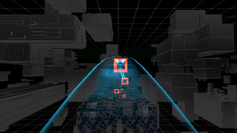

# aigp

Run a controller against the AIGP simulator. Put your controller in `controllers/`.

Install dependencies from the repository root with Python 3.11 or newer:

```sh
python -m pip install -e ".[aigp]"
```

Run:

```sh
cd target/aigp
python simulator.py vq1.r1 --controller r1_gates
python simulator.py vq1.r1 --controller r1_body_rates
python simulator.py vq2.r1 --controller zero
python simulator.py vq2.r2 --controller zero
```

Targets select the build and track. Runs use the direct arena.
Training and Qualification event selection is not implemented.

`r1_gates` flies six gates using the simulator's position control.
`r1_body_rates` computes position and attitude control, then sends body rates
and thrust. `zero` sends zero thrust.

`r1_motors` adds our rate PI and mixer, then sends four individual motor controls.



One recorded `r1_motors` flight: **9.819 s**, six gates, zero collisions, exact
command and signal replay. Native camera footage plays at normal speed.
Continuous flight reliability is still being improved.

Run its recorded six-gate verification from the repository root:

```sh
python -m test.aigp_regression r1_motors
python -m test.aigp_regression r1_motors --reference test/fixtures/vq1_r1_35s.npz
```

`--reference` uses the saved 35-second position, velocity and acceleration plan
with the existing PID follower, then our rate PI and mixer.

The check requires six valid gates, no collisions, motor commands throughout
the flight, and exact command/signal replay. It uses 50 Hz and a 0.3-second IMU
timeout; the runner sends zero thrust and disarms during cleanup.

Implement `update(telemetry, frames, race_state)` and return a command. Each call receives
new packets and completed images. The runner handles timing, arming, race finish,
and shutdown. See the [controller interface](controllers/README.md) and
[packet formats](docs/wiring.md).

Or call the runner directly:

```python
from target.aigp.simulator import AIGPSimulator
from target.aigp.controllers.r1_body_rates import Controller

sim = AIGPSimulator(Controller, "vq1.r1")
result = sim.rollout()
```

Create a new `AIGPSimulator` for each run.
See [examples](../../examples/aigp/) and [recording and probes](experiments/README.md).

## setup

macOS needs [Game Porting Toolkit](https://github.com/Gcenx/homebrew-wine) in `/Applications`.

```sh
brew install git-lfs python@3.11
brew install --cask gcenx/wine/game-porting-toolkit
```

Tested on macOS. Linux support is experimental and needs an x86_64 desktop with
Wine, wineserver, git-lfs, and Python 3.11 or newer.

```sh
git lfs install
git clone https://github.com/miniflight/miniflight.git
cd miniflight
git lfs pull
```

`native.py` extracts and launches the simulator through Wine. `client.py` handles
UDP. `simulator.py` runs the controller. Generated files go in `.runtime/`.

Run one simulator at a time. Ctrl+C stops the controller and the simulator it launched.
Omit `--controller` to open the simulator alone. Use `--attach --controller zero`
to connect to a running simulator; it stays open when the controller exits.
`WINE` and `WINESERVER` select a different Wine installation.
Pass Unreal options after `--`. Use full option names before it.

[Commands](docs/vehicle-api.md) · [VQ1 specification](docs/VQ1-Technical-Specification-00.02.pdf) · [VQ2 specification](docs/VQ2-Technical-Specification-00.03.pdf)
