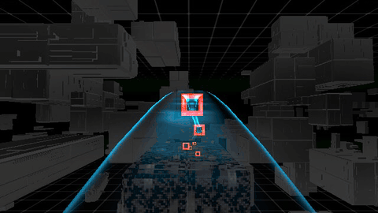

# aigp



Run a controller against the AI-GP simulator. Put your controller in
`target/aigp/controllers/`. Start with [setup](#setup) for a first VQ1 lap.

<br clear="right">

## setup

macOS needs [Game Porting Toolkit](https://github.com/Gcenx/homebrew-wine) in `/Applications`.

```sh
brew install git-lfs python@3.11
brew install --cask gcenx/wine/game-porting-toolkit
```

Tested on macOS. Linux support is experimental and needs an x86_64 desktop with
Wine, wineserver, git-lfs, and Python 3.11.4 or newer. Use your Python
executable in place of `python3.11`.

```sh
git lfs install
git clone https://github.com/miniflight/miniflight.git
cd miniflight
git lfs pull
python3.11 -m venv .venv
source .venv/bin/activate
python -m pip install -e ".[aigp]"
python -m target.aigp.simulator vq1.r1 --controller r1_body_rates
```

## examples

Run from the repo root with the virtual environment active.

```sh
python -m target.aigp.simulator vq1.r1 --controller r1_gates
python -m target.aigp.simulator vq1.r1 --controller r1_body_rates
python -m target.aigp.simulator vq2.r1 --controller zero
python -m target.aigp.simulator vq2.r2 --controller zero
```

Targets select the build and track and launch straight into the arena.
For stock VQ2 Track Practice, see the [VQ2 checkpoint](../../examples/aigp/vq2-sub20/).
It includes a clean **19.928 s** lap using camera, IMU and a carried map. The
ten-run repeat had one clean sub-20 lap.

The VQ1 arena disables interaction with its results grids: pending selections
can block an ACKed MAVLink reset. The repeat runner still uses command 31000
and waits for fresh native race state and pose before starting the next flight.

`r1_gates` flies six gates using the simulator's position control.
`r1_body_rates` computes position and attitude control, then sends body rates
and thrust. `zero` sends zero thrust.

`r1_motors` adds our rate PI and mixer, then sends four individual motor controls.

With a **9.819 s** reference, `r1_motors` flew ten native laps in
**9.780–9.860 s**. Each cleared all six gates with zero collisions. All 6,423
control updates replayed exactly. See the [verification record](../../test/fixtures/vq1_r1_sub10.validation.json).

Run the six-gate regression from the repo root. It flies a fresh lap and
checks the recorded commands against replay.

```sh
python -m test.aigp_regression r1_motors
python -m test.aigp_regression r1_motors --reference test/fixtures/vq1_r1_35s.npz
```

`--reference` uses the saved 35-second position, velocity and acceleration plan
with the existing PID follower, then our rate PI and mixer.

The check requires six valid gates, no collisions, motor commands throughout
the flight, and exact command/signal replay. It uses 50 Hz and a 0.3-second IMU
timeout; the runner sends zero thrust and disarms during cleanup.
Cleanup waits for a newly received disarmed heartbeat. Missing confirmation fails
an otherwise successful run; an existing flight error is preserved.

Put your code in `target/aigp/controllers/mine.py` and export
`class Controller(BaseController)` with `update(telemetry, frames, race_state)`.
Return a command. See the [small controller example](controllers/README.md).

```sh
python -m target.aigp.simulator vq1.r1 --controller mine
```

Read physical observations through `vehicle.state`. AIGP events retain
their raw packets. The runner handles timing, arming, race finish, and
shutdown. See the [packet formats](docs/wiring.md).

Or call the runner directly:

```python
from target.aigp.simulator import AIGPSimulator
from target.aigp.controllers.r1_body_rates import Controller

sim = AIGPSimulator(Controller, "vq1.r1")
result = sim.rollout()
```

Create a new `AIGPSimulator` for each run.
See [examples](../../examples/aigp/) and [recording and probes](experiments/README.md).

## runner details

`native.py` extracts and launches the simulator through Wine. `client.py` handles
UDP. `simulator.py` runs the controller. Generated files go in `.runtime/`.

Run one simulator at a time. Ctrl+C stops the controller and the simulator it launched.
Omit `--controller` to open the simulator alone. Use `--attach --controller zero`
with an open VQ1 R1 sim. It stays open when the controller exits.
`WINE` and `WINESERVER` select a different Wine installation.
Pass Unreal options after `--`. Use full option names before it.

[Commands](docs/vehicle-api.md) · [VQ1 specification](docs/VQ1-Technical-Specification-00.02.pdf) · [VQ2 specification](docs/VQ2-Technical-Specification-00.03.pdf)
