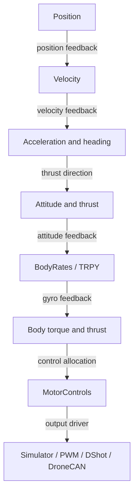

# AIGP commands

The arena supplies native arrivals through
[`BaseController.update(telemetry, frames, race_state)`](../controllers/README.md).
`SimulatorClient.send` encodes the returned command. The runner handles arming
and disarming.

The usual multirotor control boundaries form one signal path. A command can
enter at any supported boundary; the receiving target runs the stages below it.



Here TRPY means collective thrust plus FRD roll, pitch and yaw **rates** in
rad/s: it is already `BodyRates`. Torque is the output of rate feedback.
Mixing rates directly would skip that feedback loop.

The split depends on the target's supported commands, exposed by `commands`.
Our current `BodyRates` path leaves rate feedback and allocation inside AIGP.
The `MotorControls` path lets Miniflight own both. A companion computer or MCU
can implement several boundaries; the processor name does not select one.

The VQ1 build-3391 native receiver implements six control modes. All six have
native flight evidence; the acceleration, attitude and motor checks below were
run on 2026-10-08. The PDF's two named messages omit the direct actuator message.

| Native request | MAVLink message | Mask | Typed adapter |
| --- | --- | --- | --- |
| Position, metres NED | `SET_POSITION_TARGET_LOCAL_NED` (84) | 3576 | `PositionNed` |
| Velocity, m/s NED | same | 3527 | `VelocityNed` |
| Acceleration, m/s² NED; force, N | same | 3135; force 3647 | raw |
| Attitude, wxyz quaternion, and thrust 0–1 | `SET_ATTITUDE_TARGET` (82) | 7 | raw |
| Body rates and thrust 0–1 | same | 144 for native rad/s | `BodyRates`, FRD conversion |
| Four direct motor controls, 0–1 | `SET_ACTUATOR_CONTROL_TARGET` (139) | none | `MotorControls` |

`SimulatorClient.send` exposes the four typed commands; `client.mav` exposes
the raw forms. The runner owns arming, race timing, heartbeats and command cadence.
The [MAVLink definitions](https://mavlink.io/en/messages/common.html#SET_POSITION_TARGET_LOCAL_NED)
define the fields; native support was checked separately against the executable.

Native acceleration becomes desired roll/pitch and collective thrust, followed
by the native attitude/rate loops. It has no acceleration-error feedback. Each
tilt angle is limited to ±0.4 rad (22.9°). Vertical thrust is
`clamp(mass * (9.81 - down_acceleration) / 29.9, 0, 1)`, without tilt compensation.
Force mode divides the three requested values by mass first.

Use full XYZ groups in local NED. The receiver checks bits 0, 3 and 6 for the
entire position, velocity and acceleration groups; it ignores the frame selector.
Enabled acceleration overwrites the position/velocity calculation. Otherwise,
position takes precedence over velocity. Yaw angle takes precedence over yaw rate;
ignoring both retains the previous yaw request. Rate mask 128 selects native
stick values; adding the vendor's bit 16 selects rad/s. The actuator receiver
copies controls 0–3 and ignores controls 4–7 and the group selector.

Hovering belongs to the selected plane. A fixed `PositionNed` target lets VQ1
hold position. A zero `VelocityNed` target asks it to hold zero velocity, without
specifying a fixed location. With an attitude target, the simulator stabilizes the
requested attitude; our controller must still choose thrust and tilt to hold position.
With `BodyRates`, our controller also chooses the rates needed to reach that
attitude. Zero rates request a stop in rotation. Hover needs suitable thrust and attitude.

`PositionNed` and `VelocityNed` express separate physical requests but share the
adapter's `SET_POSITION_TARGET_LOCAL_NED` encoder. The command type selects the
active fields and mask; zero-valued coordinates remain active requests.
`BodyRates` uses the attitude-target encoder. Masks and frame conversions stay
inside the adapter; `BaseController.update` returns the original command values.

`MotorControls` defines nonreversing normalized commands in [0, 1], in target
motor order. This is a command contract, not a measured native force limit.
AIGP uses four outputs; the adapter pads the remaining wire channels with zeros.
These values are not RPM.

The pure [`mix`](../../../miniflight/mixer.py) function takes collective thrust,
three normalized FRD torque efforts, and an airframe coefficient matrix:

```python
from miniflight import MotorControls
from miniflight.mixer import mix
from target.aigp import MOTOR_MIX  # measured VQ1 build 3391 order

requested = mix(.265, (.0025, 0, 0), MOTOR_MIX)
command = MotorControls(requested)
```

This is a small roll-torque request, not a roll-rate setpoint. `mix` preserves
raw requests. `r1_motors` shifts collective into [0, 1], retaining requested motor
differences. Raw requests and sent commands are recorded separately. A motor
range wider than 1 still cannot fit. No force-to-RPM calibration is implied.
[`rate_control`](../../../miniflight/rate.py) supplies PI rate feedback. It takes
FRD rate error and elapsed device time, returning torque effort and the next
integral state. [`r1_motors`](../controllers/r1_motors.py) owns that state and
feeds the result through `mix` and `MotorControls`. Real STM32 sensor/ESC drivers
remain to be built.

The rate integral starts from the first new IMU sample received after the native
arm acknowledgement. Pre-arm sample gaps and repeated samples cannot advance
that clock. Recorded signals retain both the raw IMU time and the integral's dt.

## source boundary

[PX4](https://docs.px4.io/main/en/concept/control_allocation) separates rate
feedback, thrust/torque allocation, and output drivers. Its allocator uses the
airframe geometry; output mapping assigns each motor to a physical channel.
[INAV](https://github.com/iNavFlight/inav/blob/master/src/main/fc/fc_core.c)
likewise calls `pidController`, `mixTable`, then `writeMotors`, with navigation
and attitude work upstream. The inspected Betaflight path is detailed below.

[DroneCAN ESC messages](https://dronecan.github.io/Specification/7._List_of_standard_data_types/#uavcanequipmentesc)
sit at the actuator transport boundary. `RawCommand` carries normalized signed
integer controls; `RPMCommand` carries actual RPM setpoints. An ESC may close
the speed loop. Neither message supplies the vehicle's attitude/rate controller
or chooses the motor allocation. Miniflight has no DroneCAN driver yet.

the local betaflight snapshot is release `2026.6.2` at `e0b7bb01b17b21351057e9ead2d1ab39dd44fa16`

its main PID task calls receiver command processing then the rate controller
then mixing and motor output in `src/main/fc/core.c` at `taskMainPidLoop`
`src/main/fc/rc.c` applies channel scaling rate curves and smoothing
`src/main/flight/pid.c` compares the requested rate to the filtered gyro in degrees per second
`src/main/flight/mixer.c` combines axis corrections with throttle
`src/main/drivers/motor.c` dispatches outputs to the selected ESC driver

the serial boundary is different from those internal firmware functions
`MSP_SET_RAW_RC` supplies receiver channels through `src/main/rx/msp.c`
the MAVLink receiver accepts `RC_CHANNELS_OVERRIDE` through `src/main/rx/mavlink.c`
neither is a physical body rate setpoint without the configured channel mapping and rate curve
`MSP_SET_MOTOR` writes `motor_disarmed` values used by the disarmed mixer path
it sets motor test outputs while disarmed

`MSP_RAW_IMU` returns accelerometer ADC counts and gyro degrees per second without a device timestamp
a serial adapter must resolve sensor scaling frames and timing before exposing vehicle observations
those wire values cannot be passed through as this API's timestamped SI samples

this release also has optional navigation and MAVLink mission support
there is no betaflight Python target implemented here

## simulator boundary

the installed VQ1 and VQ2 build 3391 executables were checked against the existing Ghidra analysis

| binary | sha256 |
| --- | --- |
| vq1 | `d5bec020a98a0def0bf5b124b57d38189e78fbb173a5ec81697aad25c0efbec9` |
| vq2 | `68dfd80d5c9057ec92785baad61194bf5d178ddde8d6df66a6add4da5d83332b` |

VQ2 retains the body rate attitude local NED and actuator input handlers
its attitude local position and odometry output workers are stubs in both R1 and R2
the client exposes position, velocity, body rate and individual motor command paths
it decodes native telemetry

The acceleration and attitude forms still use the
[raw wire interface](wiring.md#the-remaining-wire-interface). The 2026-10-08 audit
traced dispatch at `0x14104bf70`, NED at `0x14104b8f0`, and attitude at
`0x14104b4f0`. VQ2 has matching NED receiver control flow and constants;
its flight response was not measured.

VQ1 tests sent commands at 50 Hz after a 0.6-second steady position hold, then
returned to that hold between pulses. Actual outgoing packets and native pose,
IMU and motor packets are in `.runtime/measurements/control-planes-20261008/`
with the probe source, binary/source hashes, summaries and disassembly.
All completed traces have exact controller replay, one arm/disarm pair and no collisions.

| Native test | Observed response |
| --- | --- |
| Velocity ±1 m/s north for 1.5 s | End velocity about ±0.915 m/s |
| Acceleration ±2 m/s² north/east | Late velocity slopes about ±1.8 m/s² |
| Acceleration +1 / −1 m/s² down | +1.56 / −1.28 m/s² |
| Acceleration +8 m/s² north | 22.94° pitch; +3.48 m/s² |
| Force +1 N north | 7.23° pitch; +1.18 m/s² |
| Raw quaternion pitch +5° / −5° | FRD pitch −5.01° / +5.01° |
| Four motor values 0.22 / 0.30 | Reported outputs about 0.22 / 0.30; descent / ascent |

These are measured transients, not exact acceleration tracking. The attitude
probe covers pitch; complete quaternion axis conversion remains uncalibrated.

On 2026-10-12, eight individual motor pulses (±0.005 around settled hover,
requested duration 0.15 s) established the FRD response below. The corner names
agree with the vendor's order and the observed roll/pitch torque signs.

| Wire index | Motor | Roll / pitch / yaw response to an increase |
| --- | --- | --- |
| 0 | Front left | + / + / − |
| 1 | Front right | − / + / + |
| 2 | Rear left | + / − / + |
| 3 | Rear right | − / − / − |

Six further pulses used `MOTOR_MIX`, with ±0.0025 effort on one axis at a time.
Each produced the requested rotation sign, predominantly on that axis. The
individual and mixed runs replayed 934 and 820 updates exactly, with no collisions
and one arm/disarm pair each. This establishes order and signs near hover, not
physical torque units or a tuned rate controller. Raw packets, sources, source
hashes and summaries are in `.runtime/measurements/motors-20261012/`.

the bundled [specification](VQ1-Technical-Specification-00.02.pdf) defines the NED and body frames
the [vendor controller](reference/PyAIPilotExample-v4/controller.py) defines the build 3390 radian extension
the adapter preserves that bit and the existing NED masks
standard message fields are defined by [MAVLink](https://mavlink.io/en/messages/common.html#SET_ATTITUDE_TARGET)

Live VQ1 build-3391 pulses exposed angular sign differences on the wire.
The adapter negates all three transmitted body rates. Received fields keep their
wire signs; `Vehicle.state` contains the target's FRD/NED observation mapping.
`SimulatorClient.telemetry` is a read-only view of the latest original MAVLink
messages, keyed by message name. A held view follows later packets.
The [measurements and captured regressions](body-rates.md) establish this conversion
against attitude changes, NED motion, and the camera heading; VQ2 has not received
the same physical-response validation.

The runner passes ordered packet arrivals and completed camera frames to the
controller. `r1_gates` returns `PositionNed`; `r1_body_rates` returns `BodyRates`.

## track input

`TrackInfo` arrives on the packet that completes a native course transfer.
Its gates retain raw NED mesh pivots, wxyz orientations and overall bounds.
At track load, the native bridge reads each `GateMesh` world-space bounds center
and converts it to local NED. `race_state.gate_centers` retains these separately;
the controller uses them without changing the published gate fields.
`SimulatorClient.gates` caches the last complete transfer, including redacted values.

The captured VQ1 build 3391 packet is preserved in `test/fixtures/vq1_track.json`.
All six R1 square gates have a 1.48 m clear opening, centered 1.068231 m above
the mesh pivot. The reported 2.72 m height spans the outer bounds; its halfway
point is 0.292 m above the physical opening center.
