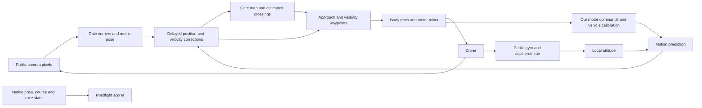

# camera + imu

Public-sensor course pilot:

```sh
python -m target.aigp.experiments.camera_imu course OUTPUT --gates 6 --speed 5 \
  --dynamics-model target/aigp/experiments/camera_imu/dynamics.model.json \
  --partial-gate --crossing-constraint
```

Each course run writes `plots/` and `plots/metrics.json` after scoring and replay.
Rebuild them with `python -m target.aigp.experiments.camera_imu.plots OUTPUT`.
Native reference curves are scorer outputs; they never enter navigation.
`pipeline.json` records input cadence, observation quality, state errors, stage
wall/thread CPU time, host command intervals and actuation. Raw public sensor
inputs and measured pixel constraints remain separate from scoring references.
[pipeline.spec.json](pipeline.spec.json) defines state ownership, limits and the
remaining estimator/planner gaps. It defines the joint fixed-lag filter;
the default pilot uses complementary corrections; `--joint-estimator` enables
the joint filter below.
Host receipt-to-send delay, estimated sensor clock age and velocity-fit age are
separate measurements. Actual exposure-to-actuation delay remains unknown.



The pilot receives no native pose, attitude, course geometry, gate counter, GO or
finish state. Its start uses a fixed allowance after an acknowledged reset. Its
own crossing estimates advance the mission. Clock alignment uses public sensor
timestamps and packet arrival times. The course profile loads no native sensor
DLLs. Public acceleration supports initial gravity calibration and takeoff.
After the first confirmed gate, our motor commands and vehicle model predict
translation; camera velocity innovations learn a residual acceleration bias.
Position and heading use a local frame chosen at the stationary start.
`replay --poison` also falsifies native race start, validity and finish for this
profile. Raw traces are temporary and bounded; the course video and scores remain.

| Native navigation signal | Estimated replacement |
| --- | --- |
| Attitude | Gravity initialization and public gyro integration |
| Position and velocity | Gate-relative camera measurements, causal velocity fits and command-model prediction |
| Gate poses and order | Known-size image geometry and current/next-gate hypotheses |
| Gate progress | Camera-range crossing estimates propagated with estimated displacement |

The force model now comes from public image geometry, gyro-derived attitude and
our commands. No native or fused translation labels enter its fit. The 1.64 MB
input fixture is `test/fixtures/public_dynamics`; `dynamics.py` reproduces its fit
and `--shared-drag MODEL` writes the selected three-parameter model. Larger thrust
and speed remain outside its narrow calibration support. New course runs require
an explicit model.

The crossing constraint checks predicted transverse position before blind entry.
Three frozen trials passed twice, at 51.64/52.61 s with no contact; one stopped at
gate four after losing usable measurements. The preceding baseline passed once
in three trials. All six normal and poisoned replays matched. These small cohorts
have independent timing/noise. All 18 public-model development attempts, failures,
source hashes and pipeline measurements are in
[public-dynamics.validation.json](public-dynamics.validation.json).
[Crossing measurements](crossing.validation.png) show the observed failure.

Earlier [course](course.validation.json) and [gravity](gravity.validation.json)
results used native-fitted force constants. The `joint` experiments below also
used instrumented sensor timing. They remain archived comparisons.

Joint feedback with one slow gate and an explicit brake/resume:

```sh
python -m target.aigp.experiments.camera_imu course OUTPUT --gates 1 --speed 2 \
  --dynamics-model target/aigp/experiments/camera_imu/dynamics.model.json \
  --partial-gate --crossing-constraint --joint-estimator --brake-test
```

Raw pixels and public body-force measurements update position, velocity,
attitude and gate geometry in one covariance. Delayed images rewind and replay
the subsequent gyro, command and measurement history. The nominal 1.5 m gate
size stays fixed; its uncertainty remains in the covariance. Three unchanged
live trials braked, resumed and crossed without contact or resets. Braking RMS
was 0.36–0.49 m position, 0.37–0.41 m/s velocity, 0.31–0.56 degrees attitude and
0.15–0.17 m camera depth. All normal and poisoned replays matched. Earlier
failures and uncertainty limits: [gate-filter.validation.json](gate-filter.validation.json).
The planner still uses the posterior mean rather than a timed covariance constraint.

Six gates with the same joint observer and no coordinate reset:

```sh
python -m target.aigp.experiments.camera_imu course OUTPUT --gates 6 --speed 5 \
  --dynamics-model target/aigp/experiments/camera_imu/dynamics.model.json \
  --partial-gate --crossing-constraint --joint-estimator --moving-start
```

The current revision completed one clean lap in 46.41 s. Position/velocity/attitude/
depth MAE was 1.40 m / 0.34 m/s / 0.53 degrees / 0.40 m, including startup.
An earlier send-time-only revision failed after four gates. All eight development
attempts, exact replay checks and limits are in [the course report](gate-filter.course.validation.json)
and [comparison plots](gate-filter.course.validation.png). This is not an unchanged robustness cohort.

Replay the recorded braking failure; `reference/` is read only by the scorer:

```sh
python -m target.aigp.experiments.camera_imu.gate_filter_replay \
  test/fixtures/joint_braking OUTPUT --tracks test/fixtures/joint_braking/public-tracks.jsonl.gz
python -m target.aigp.experiments.camera_imu.gate_filter_score test/fixtures/joint_braking OUTPUT
```

Joint position, velocity and depth feedback for one slow 20-degree turn:

```sh
python -m target.aigp.experiments.camera_imu joint OUTPUT --shift -.5
python -m target.aigp.experiments.camera_imu.joint_score OUTPUT
```

The turn runs at 1 m/s after camera initialization. Gate pose updates stop before
takeover. The same joint estimate drives the turn and braking. The second command
recomputes retained optimizer inputs; native pose is used only by the flight scorer.
Raw traces are temporary; only compact scores, optimizer inputs and a short clip remain.
The final profile passed two unchanged live repetitions. Position RMS was
0.04/0.23 m and velocity RMS 0.015/0.080 m/s. Gate pose observations stopped before
joint takeover. Four earlier failures and the endpoint limits are in
[joint.validation.json](joint.validation.json).

Return observations of the same mapped gate after a one-second gap:

```sh
python -m target.aigp.experiments.camera_imu joint OUTPUT --shift -.5 --joint-init reprojection --gate-return
```

The first and latest measured gate views remain in the fit after the gate leaves
view. Gate corrections disabled on the same sensor inputs provide a causal replay
comparison. All trials and failures are in [gate-return.validation.json](gate-return.validation.json).

One gate with camera position/velocity correcting the IMU estimate:

```sh
python -m target.aigp.experiments.camera_imu one target/aigp/.runtime/gate-estimator/run-01 --shift -.5
```

Background-map replay uses `source-lossless.mp4`, `camera-input.json` and
`gyro-input.json` in `SENSORS`. Native reference poses remain in `FLIGHT` for scoring:

```sh
python -m target.aigp.experiments.camera_imu.background SENSORS
python -m target.aigp.experiments.camera_imu.background_score FLIGHT SENSORS
```

`background SENSORS --map-uncertainty` compares covariance-weighted `multi`
against the original twelve-view fit as `uniform`, using the same map points.
The mixed fresh-turn result is in [uncertainty.validation.json](uncertainty.validation.json);
weighting remains optional.

Two fresh turn comparisons are in [multiview.validation.json](multiview.validation.json).
Those background-map comparisons ran in replay. The newer `joint` mode above
uses a continuously updated position, velocity and depth fit for live feedback.

This runs at 2 m/s. Gate size and pixels supply translation; IMU rotation puts
measurements in one local frame. A 0.5 s camera history supplies velocity.
Position and velocity corrections apply at their measurement times and carry
forward through the IMU history. Corrections require all aperture sides to be
at least 60 pixels long and reprojection RMS at most 1 pixel. The gate anchor
stays fixed after the first frame meeting those conditions.
`score.json` reports gate-relative position/velocity errors for camera, corrected
IMU and an uncorrected IMU on the same flight, plus capture-to-controller-output
age and the velocity fit's effective age. Simulator motion is read only by the
post-flight scorer. Full traces and images are temporary, capped at 128 MiB per
trace, and deleted after normal replay and poisoned-state replay. Only small
summaries and a camera-error CSV remain.

The final frozen controller passed 2/2 one-gate runs from opposite sideways
starts. Across those flights, corrected gate-relative position/velocity RMS
was 0.125 m / 0.066 m/s; uncorrected IMU on the same flights was
0.249 m / 0.107 m/s. Trusted camera observations were 0.095 m / 0.090 m/s RMS.
Median capture-to-output age was 31 ms. The velocity fit's effective time was
234 ms before its latest image, accounted for by the delayed IMU correction.
Earlier failures and exact replay checks are in
[estimation.validation.json](estimation.validation.json). These are simulator
results for one gate; IMU orientation still supplies the common frame.

From the repository root, with Python 3.11+, Wine and MinGW-w64 installed:

```sh
python -m pip install -e '.[aigp,planning]'
python -m target.aigp.experiments.camera_imu build
python -m target.aigp.experiments.camera_imu live target/aigp/.runtime/camera-imu/run-01 --shift -.5
python -m target.aigp.experiments.camera_imu replay target/aigp/.runtime/camera-imu/run-01/flight.jsonl --poison
python -m target.aigp.experiments.camera_imu score target/aigp/.runtime/camera-imu/run-01
python -m target.aigp.experiments.camera_imu video target/aigp/.runtime/camera-imu/run-01
```

Use a new output directory for each run. `video` requires `ffmpeg`.
`live` writes `score.json`; `live` and `score` exit unsuccessfully when the
two-gate acceptance checks fail. Replay reproduces the recorded outcome,
including a retained flight failure.
`build` requires `x86_64-w64-mingw32-gcc` and `x86_64-w64-mingw32-objcopy`.
Helpers are compiled and cached under `.runtime/camera-imu-builds/`.
Tested on macOS with the repository's VQ1 R1 simulator setup.

The probes require executable SHA256
`d5bec020a98a0def0bf5b124b57d38189e78fbb173a5ec81697aad25c0efbec9`.
The runner checks it before launch and restores the normal Lua configuration
when its owned simulator stops.

Steering uses aperture pixels, a nominal 1.50 m opening, full-rate producer IMU
increments and measured capture times. Initial tilt comes from gravity with zero
local yaw. The sideways setup move uses IMU feedback, then establishes a local
origin before the approach. Both gate approaches retain the same IMU history.
The camera retains the next aperture before the handoff, and an early height
waypoint keeps it in view. Native race state handles GO and lifecycle checks.
Native pose, gate coordinates and gate count are recorded for post-flight scoring.

`replay --poison` replaces incoming native pose and gate coordinates and holds
the native gate counter at zero while comparing every controller update and
outgoing command. `score` checks native passes, crossing offsets, arming,
in-flight resets, collisions and IMU continuity. The video draws accepted image
corners in green, IMU predictions in amber and look-ahead candidates in blue.

The final prototype passed two continuous two-gate runs with the same controller.
The recordings replayed 793 and 784 commands exactly. Three earlier handoff
failures are retained in the local experiment record. Results are in
[validation.json](validation.json), with the [recorded flight](https://x.com/__miniflight__/status/2119060568414081178).

Fresh checks of this packaged entry point passed 1/2 runs. The retained failure
passed gate one but did not confirm enough look-ahead observations for gate two.
Gate-two acquisition remains intermittent.
